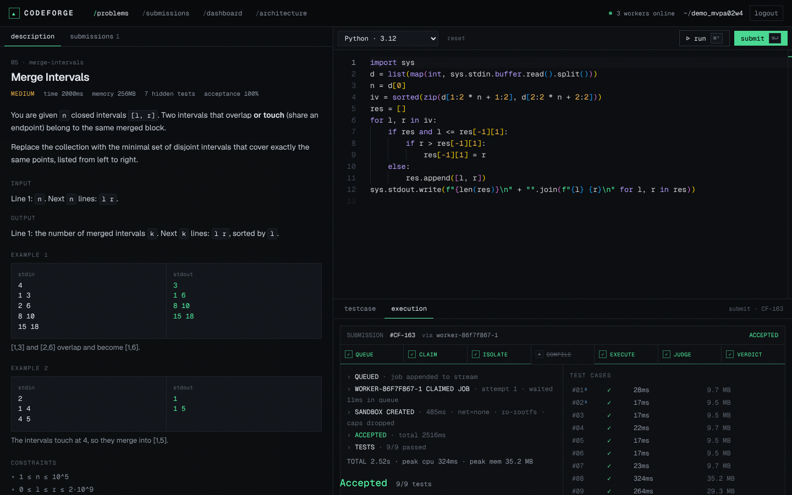
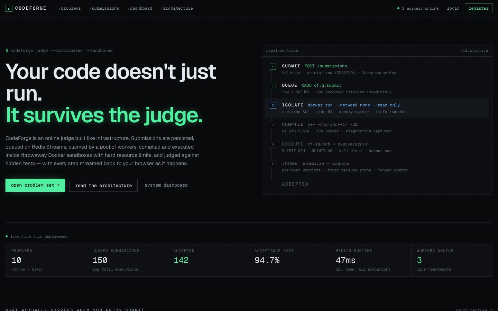
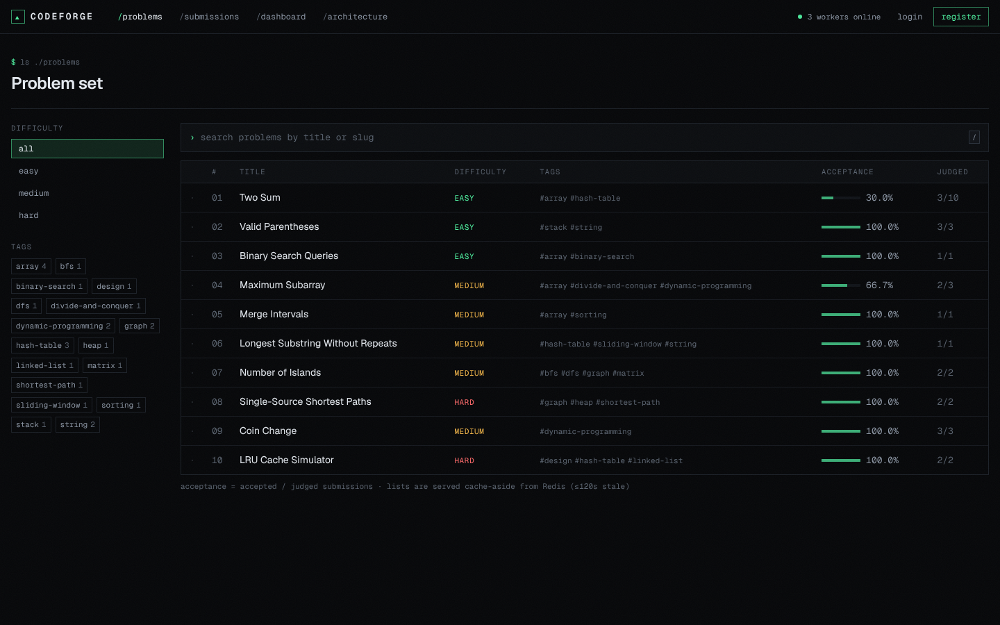
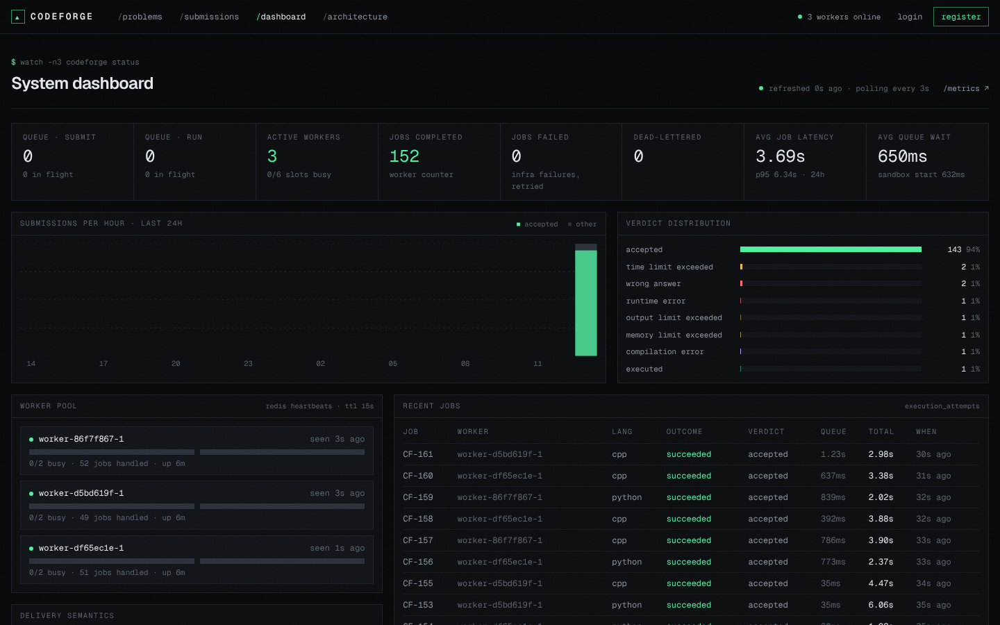
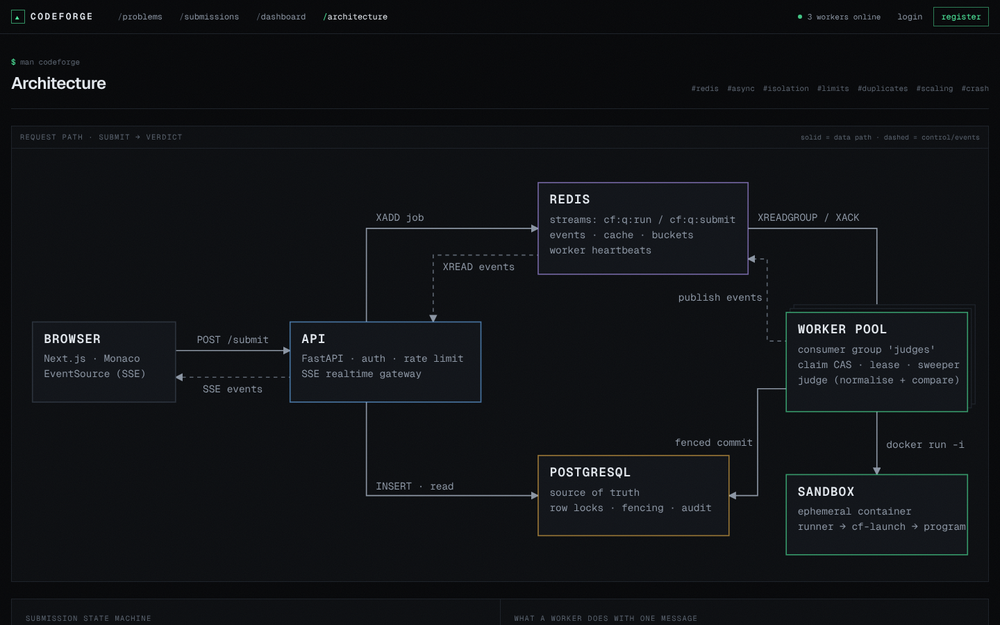
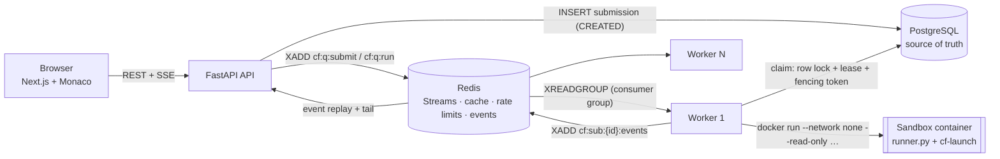

# CodeForge

**A distributed online judge.** You write Python or C++ in the browser, and an API stores the submission and hands it to a pool of workers. Each worker runs the code in a locked-down, throwaway Docker container, judges it against hidden tests, and streams every lifecycle step back to the browser.

The core loop works end to end, with nothing mocked. Each verdict on screen comes from a real process running in a real sandbox.



| Landing | Problem explorer |
|---|---|
|  |  |
| **System dashboard** (live queue, worker and latency metrics) | **/architecture** |
|  |  |

---

## Quick start

Requirements: Docker with Compose v2, on Linux or on Docker Desktop for macOS or Windows.

```bash
cp .env.example .env        # then set JWT_SECRET and POSTGRES_PASSWORD
make up                     # = docker compose up --build -d
```

| URL | What |
|---|---|
| http://localhost:3000 | Web app (landing, problems, workspace, dashboard, /architecture) |
| http://localhost:8000/docs | OpenAPI / Swagger UI |
| http://localhost:8000/health · `/ready` | Liveness · readiness (checks Postgres + Redis) |
| http://localhost:8000/metrics | Prometheus metrics (API + queue gauges) |

`make up` does five things in order:

1. Builds the API, worker, web and **sandbox** images.
2. Starts Postgres and Redis.
3. Runs `alembic upgrade head` and the idempotent seed (10 problems, 106 test cases).
4. Starts the API and one worker.
5. Starts the web app.

To scale the worker pool, run `make worker WORKERS=4`. Other targets are listed by `make help`.

> The worker talks to the host Docker daemon through `/var/run/docker.sock` so that it can start sibling sandbox containers. See [Security model](#security-model) for what that implies.

---

## Architecture



| Component | Responsibility |
|---|---|
| `apps/web` | Next.js 16 / React 19 / Tailwind 4 UI. Monaco is served locally. A pure reducer turns SSE events into the pipeline visualiser. |
| `apps/api` | FastAPI: auth, problems, submissions, SSE gateway, stats, metrics. **Never executes user code.** |
| `apps/worker` | Queue consumer, lease/claim logic, sandbox driver, judge, leader-elected sweeper, heartbeats, Prometheus exporter on `:9100`. |
| `packages/core` | Shared SQLAlchemy models, the submission state machine, queue/event helpers, settings and Redis keys. |
| `infrastructure/sandbox` | The sandbox image: `runner.py` (JSON-lines protocol) and `cf-launch`, a small static C launcher that drops privileges, sets rlimits and reports `wait4` rusage. |

More detail is in [docs/ARCHITECTURE.md](docs/ARCHITECTURE.md), and the decisions are in [docs/adr/](docs/adr/README.md).

### Submission lifecycle

```
CREATED → QUEUED → CLAIMED → PREPARING → COMPILING → RUNNING → JUDGING → COMPLETED (verdict)
   ↘ any non-terminal state can go to CANCELLED / INTERNAL_ERROR; RUNNING etc. → QUEUED on retry
```

- **Enforcement.** Transitions are enforced by a table in `packages/core/codeforge_core/state_machine.py`. Every transition is a guarded `UPDATE … WHERE status = ANY(:allowed_sources)` under a row lock, and is audit-logged in `submission_transitions`, so an invalid transition raises instead of silently overwriting.
- **Status vs verdict.** *Status* (where the job is) and *verdict* (what the code did) are separate columns. A `CHECK` constraint makes `verdict IS NOT NULL` hold exactly when `status = 'COMPLETED'`.
- **Verdicts:** `ACCEPTED`, `WRONG_ANSWER`, `TIME_LIMIT_EXCEEDED`, `MEMORY_LIMIT_EXCEEDED`, `RUNTIME_ERROR`, `COMPILATION_ERROR`, `OUTPUT_LIMIT_EXCEEDED`, plus `EXECUTED` for Run Code.

---

## Technical highlights

- **At-least-once queue, exactly-once effects.** Jobs live in Redis Streams consumer groups.
  - Delivery is at-least-once: messages are only `XACK`ed after the DB says the job is finished, and a dead worker's messages are reclaimed with `XAUTOCLAIM` after a visibility timeout.
  - Effects are exactly-once because the DB claim is the real gate. A second delivery of the same job finds the row already claimed or finished and is acked as a duplicate.
- **Leases and fencing tokens.** A claim sets `lease_expires_at`, `worker_id` and `attempt`. The worker renews the lease between tests, and every later write is fenced on `(worker_id, attempt)`, so a paused or partitioned worker that wakes up after its lease was taken over cannot overwrite the new owner's result.
- **Transactional outbox.** The API commits the row as `CREATED`, then publishes, then flips it to `QUEUED`. If the API dies between those steps, a leader-elected sweeper republishes stale `CREATED` rows. The sweeper also requeues expired leases (up to `MAX_ATTEMPTS`, then `INTERNAL_ERROR`) and stuck `QUEUED` rows.
- **Poison messages.** A message delivered more than 5 times goes to a dead-letter stream (`cf:q:dead`) and its submission becomes `INTERNAL_ERROR`, so it cannot loop forever.
- **Fair priorities.** Run Code and Submit have separate streams. Interactive runs go first, with an anti-starvation burst limit so submissions keep moving.
- **Accurate resource accounting.**
  - Memory is measured with `wait4` rusage taken by a tiny C launcher (`cf-launch`), not by the Python runner. `ru_maxrss` is inherited across fork+exec, so measuring from Python would report Python's own ~12 MB as the floor for every C++ program.
  - CPU time and wall time are measured separately, and TLE uses both, so `sleep()` cannot dodge the limit.
- **Hidden tests stay hidden.** Expected outputs never enter the sandbox (judging happens in the worker). The API never returns hidden inputs or outputs, and the worker never stores a hidden test's stdout/stderr.
- **Real-time results over SSE.** Each submission has an event stream in Redis (`cf:sub:{id}:events`). The SSE endpoint replays from `Last-Event-ID`, so reconnects are lossless. It sends heartbeats every 15 s and falls back to DB polling if Redis is unavailable.
- **Cache-aside with generation-based invalidation** for problem lists and details, plus a short lock against cache stampedes. Hidden test data is never cached.
- **Token-bucket rate limiting** runs atomically in Lua using Redis `TIME`, and returns `429` with a `Retry-After` header.

The full queue and failure-mode analysis is in [docs/QUEUE_AND_CONCURRENCY.md](docs/QUEUE_AND_CONCURRENCY.md).

---

## Security model

Untrusted code runs only inside a fresh container per submission. The worker builds the `docker run` command as an argv list, with no shell. These are the controls actually applied:

| Control | How |
|---|---|
| No network | `--network none` |
| Read-only root FS | `--read-only`; the only writable path is `/sandbox`, a size-capped `tmpfs` mounted with `nosuid,nodev` |
| No host mounts | Source is sent over stdin; nothing from the host is bind-mounted |
| Non-root | The program runs as uid/gid **65534** (dropped by `cf-launch` via `setgid`/`setuid`) |
| Capabilities | `--cap-drop ALL`; only `SETUID`/`SETGID`/`KILL` are re-added for the launcher's privilege drop; `--security-opt no-new-privileges` |
| Memory | Container `--memory` = `--memory-swap` (no swap), plus `RLIMIT_AS` per program and a per-language headroom |
| CPU / time | `--cpus 1`, `RLIMIT_CPU`, a wall-clock kill in the runner, and an outer job timeout in the worker that kills the container |
| Processes | `--pids-limit 64` (a fork bomb is tested and contained) |
| Output | Per-test stdout cap of `max(1 MiB, 2×expected + 4 KiB)`, so a submission that floods output is killed with `OUTPUT_LIMIT_EXCEEDED` |
| IPC / logs | `--ipc none`, `--log-driver none`, `--init` |
| Cleanup | `--rm`, explicit `docker rm -f` on timeout, and a startup reaper for anything labelled `codeforge.sandbox=1` |

Application security covers the following:

- Argon2id password hashing, with a timing-equalised check for unknown users.
- JWTs with `exp`/`iat`/`jti`/`iss`, carried in an httpOnly SameSite=Lax cookie or a Bearer header.
- Server-side logout revocation.
- Authorisation checks that return 404 rather than 403 for other users' submissions.
- Pydantic validation with size limits on source and input.
- Structured error envelopes that never leak stack traces.
- Secrets that come only from the environment. The API refuses to start with the development JWT secret outside development.

**Honest limits.** Docker containers share the host kernel, so a kernel exploit could escape. The worker also has access to the Docker socket, which is effectively root on that host.

This design is reasonable defence in depth for a portfolio or teaching judge on a dedicated host. It is **not** hostile multi-tenant isolation. For that you would want gVisor (`--runtime=runsc`), Firecracker microVMs or nsjail plus a custom seccomp profile, with workers on isolated hosts. The details and the threat model are in [docs/SECURITY.md](docs/SECURITY.md) and [ADR 0006](docs/adr/0006-limits-of-docker-sandboxing.md).

---

## Data model and Redis usage

PostgreSQL is the source of truth: `users`, `problems`, `tags`, `test_cases` (public/hidden), `languages`, `submissions`, `submission_results`, `execution_attempts`, `submission_transitions`. The schema has foreign keys, `CHECK` constraints and partial and composite indexes for the hot queries, and is managed with Alembic migrations. A unique `(user_id, idempotency_key)` index makes retried POSTs safe. See [docs/DATABASE.md](docs/DATABASE.md).

Redis is only ever a derived or ephemeral layer, so losing it loses no submissions. The sweeper republishes from the DB.

| Key | Purpose | TTL |
|---|---|---|
| `cf:q:submit`, `cf:q:run`, `cf:q:dead` | Job streams (consumer group `judges`) | — |
| `cf:sub:{submission_id}:events` | Per-submission event stream for SSE replay | 1 h |
| `cf:cache:problems:v{gen}:list:*` / `:detail:{slug}` | Cache-aside problem list/detail; bumping `cf:cache:problems:gen` invalidates | 120 s / 300 s |
| `cf:rl:{bucket}:{subject}` | Token buckets | auto |
| `cf:worker:{id}` | Worker heartbeat/registry | 15 s |
| `cf:lock:sweeper` | Sweeper leader lock (`SET NX PX` + Lua renew) | 15 s |
| `cf:auth:revoked:{jti}` | Logout denylist | until token expiry |
| `cf:stats:*` | Worker counters for the dashboard | — |

---

## Testing

All of the following were actually run while building this repo:

| Suite | Command | Result |
|---|---|---|
| Core + API + worker + sandbox (pytest) | `make test-backend` | **66 passed** |
| Frontend (vitest: pipeline reducer and components) | `make test-web` | **9 passed** |
| End-to-end against a live stack | `cd tests/integration && pytest` | **30 passed**, both against locally run processes and against the full `docker compose` stack with 3 workers |
| Type-check and production build | `cd apps/web && npx tsc --noEmit && npm run build` | clean |

The backend suite covers these areas:

- **State machine.** Every legal and illegal transition. Twenty threads race to claim one submission and exactly one wins. Writes from a stale fencing token are rejected.
- **Queue behaviour.** Duplicate delivery, `XAUTOCLAIM` recovery and dead-lettering.
- **Sweeper and retries.** Outbox republish, lease expiry and retry up to `INTERNAL_ERROR`, and leader election.
- **Sandbox.** It runs as uid 65534, has no network, has a read-only rootfs, and returns the right TLE, MLE, OLE and RE verdicts. A fork bomb is contained.
- **Judge.** Normalisation rules.
- **API.** Auth, pagination, hidden-test non-exposure, idempotency, rate limiting (429) and authorisation.

The E2E suite submits real Python and C++ reference solutions for all 10 problems (all `ACCEPTED`) and deliberately broken programs: WA, CE, TLE in both languages, segfault, MLE, output flood, Run Code with custom input, SSE event ordering, and concurrent idempotent POSTs.

**Running the backend tests locally** requires Python 3.12+, PostgreSQL with a `codeforge_test` database owned by `codeforge`, Redis (the tests use DB 15), and Docker with the sandbox image built (`make sandbox-image`). Run `make dev-install` first. The tests that need Docker skip themselves if no daemon is available.

### Load test (real run, raw results committed)

`make loadtest` runs Locust headless and records the environment next to the results. The run in [`tests/load/results/20261026T130930Z/`](tests/load/results/20261026T130930Z/) used this setup:

- 40 users (30 browsing, 10 submitting real solutions and polling until the verdict) for 90 s;
- the full Compose stack with **3 workers × 2 slots**;
- one 4-vCPU / 15 GiB VM that also ran the load generator.

| Endpoint | Requests | Failures | p50 | p95 | p99 |
|---|---|---|---|---|---|
| `GET /problems` (cached) | 1,462 | 0 | 14 ms | 78 ms | 180 ms |
| `GET /problems/{slug}` (cached) | 2,359 | 0 | 14 ms | 78 ms | 170 ms |
| `POST /submissions` | 122 | 0 | 81 ms | 260 ms | 330 ms |
| Submit → verdict (client-observed, end to end) | 115 | 0 (all ACCEPTED) | 5.7 s | 8.6 s | 10 s |

The aggregate was about 63 req/s with 0 errors. The submit-to-verdict latency is dominated by queueing: all 6 sandbox slots were busy for the whole run, and creating each container costs about 0.5 s. Each verdict runs 7–15 tests. With more workers the queue wait shrinks; container start-up does not. Pooling warm sandboxes is listed under future work.

---

## Project structure

```
apps/
  api/          FastAPI service, Alembic migrations, seed data (10 original problems)
  worker/       queue consumer, sandbox driver, judge, sweeper, metrics
  web/          Next.js frontend
packages/core/  shared models, state machine, queue/events, settings
infrastructure/sandbox/  sandbox image: runner.py + cf-launch (C)
tests/
  integration/  end-to-end suite against a running stack
  load/         Locust scenarios, runner script and recorded results
  fixtures/     reference solutions (Python for all problems, C++ for 7)
docs/           architecture, security, execution engine, database, queue, API, ADRs
```

## Configuration

Everything is set through environment variables. [`.env.example`](.env.example) lists them with placeholder values. The ones that matter most:

| Variable | Default | Meaning |
|---|---|---|
| `JWT_SECRET` | — | **Required** outside development |
| `POSTGRES_PASSWORD` | — | DB password used by compose |
| `RATE_LIMIT_SUBMIT` / `RUN` / `AUTH` | `10/60`, `20/60`, `10/60` | Token buckets `<capacity>/<seconds>` |
| `WORKER_CONCURRENCY` | `2` | Parallel sandboxes per worker |
| `LEASE_SECONDS` / `MAX_ATTEMPTS` | `90` / `3` | Claim lease and retry budget |
| `VISIBILITY_TIMEOUT_SECONDS` | `180` | Idle time before `XAUTOCLAIM` takes over a message |
| `CODEFORGE_ADMIN_PASSWORD` | empty | If set, the seed creates an `admin` user |

The API reference is in [docs/API.md](docs/API.md) and is also served live at `/docs`.

---

## Trade-offs and limitations

- **Docker sandbox and Docker socket.** These were chosen for simplicity and portability. Both are the main security limit, as explained above.
- **Per-run container start-up (~0.5 s).** This is the dominant fixed cost. Each submission gets one container that is reused across that submission's tests, never across users.
- **Two languages.** Python 3.12 and C++17 (GCC 14). Adding one means writing a `LanguageSpec` in `packages/core/codeforge_core/languages.py` and installing the toolchain in the sandbox image.
- **Exact-match judging only.** The comparison ignores CRLF differences, trailing whitespace and trailing blank lines. There are no special checkers, such as float tolerance or multiple valid answers. Problems are written so that the answer is unique.
- **Single-region, single Postgres and Redis.** There is no HA or failover configuration. Redis loss is recoverable, as explained above; Postgres loss is not.
- **No contests, editorials or admin UI for authoring problems.** Problems are authored as Python data with generators in `apps/api/codeforge_api/seed/`.

## Future work

- gVisor or Firecracker runtime, a custom seccomp profile, and a rootless or remote Docker daemon for workers.
- A warm sandbox pool to remove container start-up from the critical path.
- Special checkers or interactors, more languages, and contests with a live scoreboard.
- Autoscaling workers on queue depth, using the `codeforge_queue_backlog` metric that is already exported.

---

## What this project demonstrates

| Area | Where |
|---|---|
| **Operating systems** | rlimits, `setuid` privilege drop, process groups, `wait4` rusage, signals (TLE/MLE/segfault classification), pids and memory cgroups via Docker, non-blocking pipe I/O with `selectors` |
| **DBMS** | normalised schema with constraints and indexes, migrations, `SELECT … FOR UPDATE`, guarded conditional updates, transactional outbox, idempotency via unique indexes, audit log |
| **Networks** | REST design, Server-Sent Events with `Last-Event-ID` resume, heartbeats, CORS and cookie semantics, network isolation of untrusted code |
| **Concurrency** | consumer groups, claim races (tested with 20 threads), leases, fencing tokens, worker thread pools, graceful SIGTERM drain |
| **Distributed systems** | at-least-once delivery with idempotent effects, crash recovery (`XAUTOCLAIM`, lease expiry), leader election, dead-letter queue, cache invalidation |
| **DSA** | 10 original problems with reference solvers and deterministic test generators (graphs, DP, sliding window, intervals, LRU) |
| **Security** | sandbox hardening, Argon2id, JWT revocation, rate limiting, hidden-test confidentiality, an explicit threat model |
| **DevOps** | multi-stage Dockerfiles, Compose with health-gated startup, Prometheus metrics, structured JSON logs with request and submission IDs, Makefile workflow, reproducible load tests |
